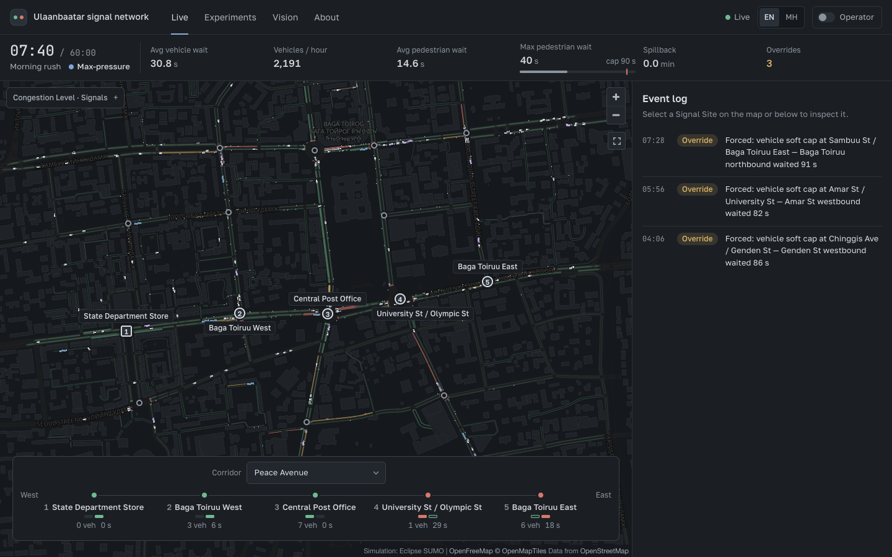
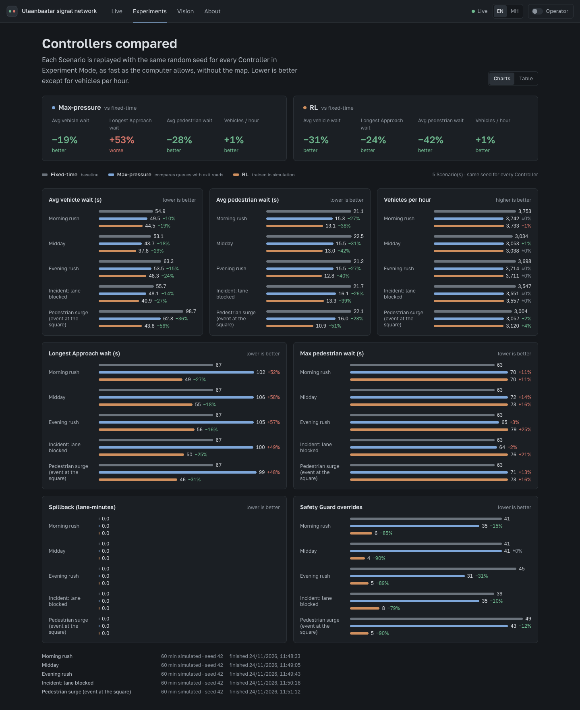

# Ulaanbaatar signal network

An open-source demo of AI traffic-signal control in central Ulaanbaatar. It controls a Network of 15 Signal Sites on streets running east-west and north-south around Sükhbaatar Square: 14 Intersections and one Mid-block Crossing, at the State Department Store. Vehicles and pedestrians are simulated on real road geometry from OpenStreetMap. Controllers decide which Phase goes green, and a Safety Guard limits how long anyone waits for green.

Fourteen of the sites lie on eight Corridors:

| Corridor | Direction | Signal Sites |
|---|---|---|
| Peace Avenue | east-west | 5 |
| Sambuu St | east-west | 4 |
| Juulchny St | east-west | 2 |
| Genden St | east-west | 2 |
| Baga Toiruu West | north-south | 3 |
| Sükhbaatar St – Chinggis Ave | north-south | 3 |
| University St – Olympic St | north-south | 4 |
| Baga Toiruu East | north-south | 2 |

A site where two Corridors cross counts in both. Seoul St / Tserendorj St is in no Corridor. Other signals inside the area run fixed programs and are drawn grey.

The words used here (Network, Corridor, Signal Site, Approach, Crosswalk, Phase, Spillback, Safety Guard and so on) are defined in [GLOSSARY.md](GLOSSARY.md). The big decisions are in [docs/adr](docs/adr).



## How it decides

- **The Controller proposes, the Safety Guard decides** ([ADR 0002](docs/adr/0002-controller-proposes-safety-guard-decides.md)). Three Controllers can be switched live:
  - **Fixed-time**: cycles Phases on a schedule, like most of the city today. This is the Baseline.
  - **Max-pressure**: gives green to the Phase whose waiting vehicles most exceed the vehicles already on their exit roads. Each Signal Site decides from its own Approaches and exits; sites do not coordinate.
  - **RL**: a phase scorer trained in the simulation.
- **Caps the Safety Guard works to, whatever the Controller wants** (defaults; an Operator can change them):
  - Pedestrians: Hard Cap **90 s**.
  - A vehicle Approach: Soft Cap **120 s**, which the Guard may extend while the Approach's exit has Spillback, and Hard Cap **180 s**.
  - Min green, pedestrian walk and clearance, yellow and all-red always run.
  - Every Override is logged with the rule that forced it.
- **Camera vision** (`vision/`) shows what a camera would feed the Controller: queued vehicles per Approach and waiting pedestrians per Crosswalk, measured on recorded street video. It is a showcase, and the simulation does not use it ([ADR 0001](docs/adr/0001-simulation-first-on-sumo.md)).

## Results

These come from Experiment Mode: each Scenario runs for one hour, with the same traffic for every Controller (`sim/data/experiments/`, seed 42). Each cell reads Fixed-time → Max-pressure → RL.

| Scenario | Avg vehicle wait | Longest Approach wait | Avg pedestrian wait | Max pedestrian wait |
|---|---|---|---|---|
| Morning rush | 54.9 → 49.5 → 44.5 s | 67 → 102 → 49 s | 21.1 → 15.3 → 13.1 s | 63 → 70 → 70 s |
| Midday | 53.1 → 43.7 → 37.8 s | 67 → 106 → 55 s | 22.5 → 15.5 → 13.0 s | 63 → 72 → 73 s |
| Evening rush | 63.3 → 53.5 → 48.3 s | 67 → 105 → 56 s | 21.2 → 15.5 → 12.8 s | 63 → 65 → 79 s |
| Incident: lane blocked | 55.7 → 48.1 → 40.9 s | 67 → 100 → 50 s | 21.7 → 16.1 → 13.3 s | 63 → 64 → 76 s |
| Pedestrian surge (event at the square) | 98.7 → 62.8 → 43.8 s | 67 → 99 → 46 s | 22.1 → 16.0 → 10.9 s | 63 → 71 → 73 s |

"Longest Approach wait" is the longest time any Approach with a Queue went without green. One vehicle can need more than one green, so it is not the longest wait of a single vehicle. "Max pedestrian wait" is likewise the longest time a waiting person went before green was offered. A person the crowd keeps from stepping off during that green stands longer, and the clock starts again (see Caps).

- **RL** has the lowest average vehicle wait, the lowest average pedestrian wait and the shortest Longest Approach wait in every Scenario. Against the Baseline it cuts the average vehicle wait by 19% to 56% and the average pedestrian wait by 38% to 51%.
- **Max-pressure** comes second on both averages in every Scenario: 10% to 36% lower for vehicles, 26% to 31% lower for pedestrians. Its Longest Approach wait is the worst of the three, 48% to 58% longer than the Baseline, and the Safety Guard's vehicle Soft Cap forces most of its Overrides.
- **Both are worse than the Baseline on Max pedestrian wait** (the longest wait for green, not the longest time standing) in every Scenario: 64 to 72 s for Max-pressure and 70 to 79 s for RL, against 63 s.
- **Throughput barely changes.** Vehicles served per hour stay within 1% of the Baseline except in the pedestrian surge (Max-pressure +2%, RL +4%). In the morning rush both serve slightly fewer (3,742 and 3,733 against 3,753).
- **Some vehicles get stuck.** SUMO removes a vehicle that has not moved for 300 s and puts it back further on (a teleport). That happened to at most 25 of 3,966 vehicles in a run. RL has more teleports than the Baseline at midday (13 against 9), in the evening rush (25 against 7) and in the incident (20 against 15); Max-pressure has more in the evening rush (17 against 7) and the pedestrian surge (17 against 16).

**Caps.** In all 15 runs the Safety Guard offered green within the Hard Caps of 90 s for pedestrians and 180 s for Approaches: the longest waits for green were 79 s and 106 s. A randomised search at the default caps also found no breach. That is evidence, not proof. Being offered green is not the same as getting across: in 3 of the 15 runs some people stood longer than 90 s at a Crosswalk, because the crowd did not clear in one green. They were 3 people in the incident with Fixed-time (up to about 125 s), and, depending on how standing is detected, 368 to 381 in the pedestrian surge with Fixed-time and 101 to 110 in the pedestrian surge with Max-pressure. In the surge runs the longest stands reach SUMO's 300 s jam limit, and some go past it. Average pedestrian wait restarts its clock in the same way. With the Operator's pedestrian cap at its minimum of 45 s, a 3-Phase Signal Site can breach the vehicle Hard Cap: a wait of 192 s was measured, and a Phase without a Crosswalk can be starved.

**Earlier results.** Results published before the 15-site Network came from a sensor that saw waiting pedestrians at only one kerb of each Crosswalk, so the earlier claim that no pedestrian waited more than 90 s did not hold. A check of those 15 runs counted people who stood over 90 s with the Crosswalk red the whole time, so crowding is not included: 99 cases in 14 runs, the longest 315 s where the metric said 71 s. Both kerbs are now sensed, and the same condition finds nobody in the 15 new runs ([ledger](docs/specs/0001-street-network/factory.md)). The old numbers are for a different road network and must not be compared with this table.

**Spillback** is 0.0 lane-minutes in every run, so it is not in the table. The earlier non-zero figures came from the road import: junctions left unjoined had exit lanes 0.2 to 7.1 m long, where a single car counted as a full road (in the old run that was traced, evening rush with Max-pressure, all 45.4 minutes were on such lanes). Those junctions are now joined and the shortest exit lane is 16.6 m. An exit lane counts as Spillback when it is 75% full; across the 15 runs the fullest reading was 78%, and all such readings in a run together rounded to 0.0 minutes. Only the first road segment after a site is measured, so 0.0 does not mean there are no queues. It does mean these runs hardly exercise the parts of the Safety Guard and the Controllers that react to Spillback.

Traffic demand is generated, not measured, so compare the Controllers with each other, not with real traffic in Ulaanbaatar.



## Run it

Requirements: Python 3.12 with [uv](https://docs.astral.sh/uv/), Node 20+ with pnpm, or Docker.

```sh
# Simulation API on :8000
cd sim && uv sync && uv run python -m corridor_sim.server

# Vision API on :8001 (optional)
cd vision && uv sync && ./scripts/fetch_sample_videos.sh && uv run uvicorn app.main:app --port 8001

# Client on :5173
cd client && pnpm install && pnpm dev
```

With Docker, `docker compose up --build` starts all three (if your default buildx builder fails, run `docker buildx use desktop-linux` first); the client is then on http://localhost:8080. For the "Explain this decision" narrator, put `OPENAI_API_KEY=...` in `sim/.env.local`. Compose reads it if it exists.

## Repository

| Path | What |
|---|---|
| `sim/` | SUMO model of the Network, Safety Guard, Controllers, live API, Experiment Mode, RL training. See [sim/README.md](sim/README.md) |
| `vision/` | YOLO vehicle and pedestrian counting on recorded video. See [vision/README.md](vision/README.md) |
| `client/` | React + Vite web client: live map, Signal Site detail, Operator controls, experiments, vision. See [client/README.md](client/README.md) |
| `docs/` | ADRs, specs and research notes |

## Data and licences

- **Road network:** © OpenStreetMap contributors, available under the [ODbL](https://www.openstreetmap.org/copyright). The extract is `sim/data/corridor.osm.xml`.
- **Sample street videos:** from Wikimedia Commons. Credits and licences are in [vision/videos/SOURCES.md](vision/videos/SOURCES.md).
- **This project:** [AGPL-3.0](LICENSE), because the vision service uses Ultralytics YOLO ([ADR 0003](docs/adr/0003-agpl-open-source.md)).
